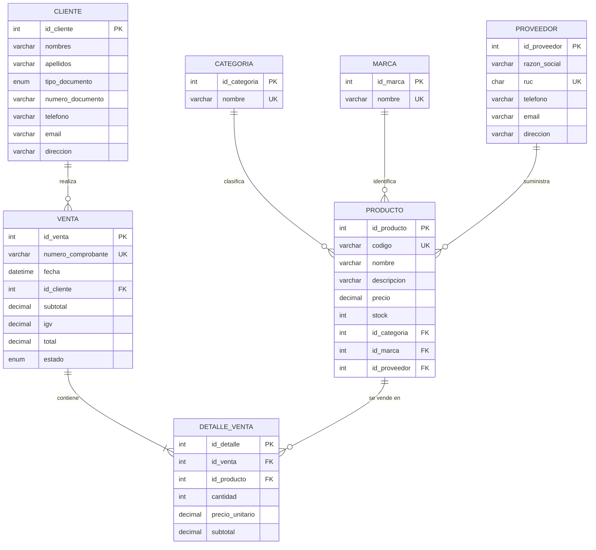

# Diagrama Entidad-Relación (DER)

> El diagrama está en formato Mermaid: GitHub lo dibuja automáticamente al abrir este archivo.

## Cardinalidades

| Relación | Cardinalidad | Explicación |
|----------|--------------|-------------|
| Categoría – Producto | 1 : N | Una categoría agrupa muchos productos; un producto tiene una sola categoría |
| Marca – Producto | 1 : N | Una marca tiene muchos productos |
| Proveedor – Producto | 1 : N | Un proveedor suministra muchos productos |
| Cliente – Venta | 1 : N | Un cliente puede hacer muchas compras; cada venta es de un solo cliente |
| Venta – Detalle de venta | 1 : N | Una venta tiene al menos un ítem |
| Producto – Detalle de venta | 1 : N | Un producto puede aparecer en muchos detalles |
| Venta – Producto (resultante) | N : M | Resuelta con la tabla `detalle_venta` |
